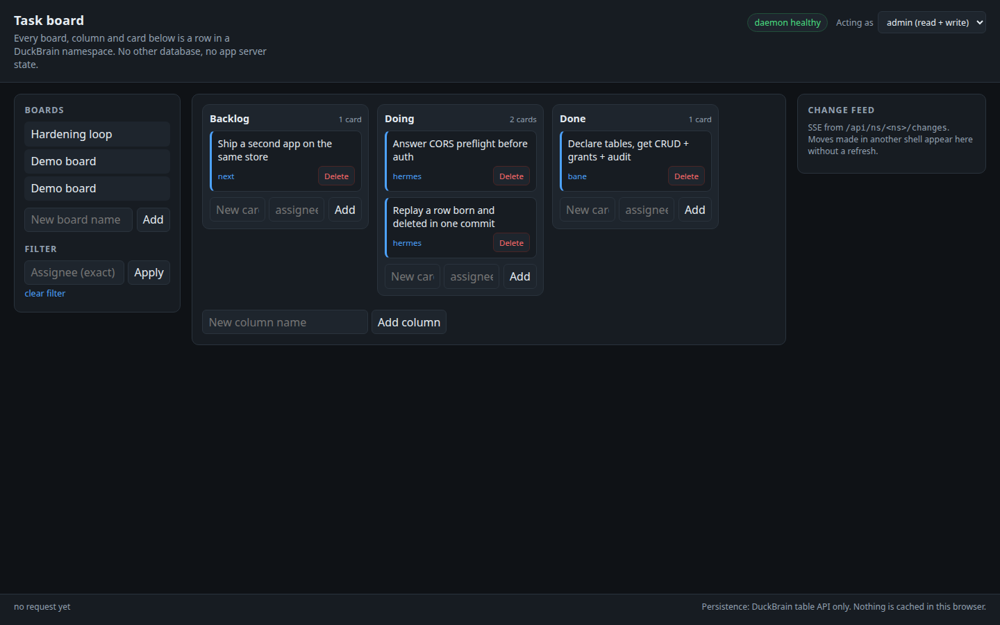

# Task board on DuckBrain

A working task board (boards → columns → cards, with drag-and-drop moves,
assignee filtering, deletes, per-table permissions and a live change feed)
whose **entire persistence is DuckBrain**. No second database, no app server
state, no JSON file of its own — the browser talks straight to DuckBrain's
generic table API.

The point is not the board. The point is that a user — or an agent — can
declare a few tables in a DuckBrain namespace and immediately get CRUD,
per-table grants, an audit ledger and a change feed for their own application.

```
browser (this app, static files)                 DuckBrain daemon
┌──────────────────────────────┐   X-API-Key     ┌───────────────────────────┐
│ index.html / app.mjs         │ ──────────────► │ /api/ns/taskboard/tables  │
│  reads  GET  .../tables/:t   │                 │   boards, columns, cards   │
│  writes POST/PATCH/DELETE    │ ◄────────────── │ /api/ns/taskboard/changes  │
│  feed   GET  .../changes SSE │                 │  (SSE, committed changes)  │
└──────────────────────────────┘                 └───────────────────────────┘
        serve.mjs = static files only, zero writes, zero storage
```

## Run it

```bash
examples/taskboard/start.sh          # bootstrap + daemon + UI
examples/taskboard/start.sh --reset  # start over with an empty namespace
```

Then open <http://127.0.0.1:8787>.



`start.sh` is the whole setup. It creates a scratch state directory
(`${TMPDIR:-/tmp}/duckbrain-taskboard` by default), writes a scratch credential
store, declares the three tables, starts a DuckBrain daemon on **:28777** with
`DUCKBRAIN_NAMESPACES_PATH` pointed at that scratch directory, and serves the UI
on **:8787**. It never touches the production daemon on :3000, `~/.duckbrain`,
or a real namespace directory.

Override with `DUCKBRAIN_PORT`, `TASKBOARD_PORT`, `TASKBOARD_STATE`.

What to try:

1. Add a board, add two columns, add cards with an assignee.
2. Drag a card to the other column — the move is a `PATCH` by primary key and
   the card's `position` is recomputed, so the order changes visibly.
3. Type an assignee in **Filter** — the list is filtered server-side
   (`?assignee=eq.<name>`), not in the browser.
4. Delete a card — a real `DELETE` by primary key.
5. Switch **Acting as → reader (read only)**: reads still work, and every add,
   move or delete is refused with `403 FORBIDDEN` and the daemon's message.
   The refusal is recorded in the namespace audit (`reason: table_grant`).
6. Watch the **Change feed**: it is an SSE subscription to
   `/api/ns/taskboard/changes`; a move made from another shell appears without a
   refresh.

## Every read and write, explicitly

All application traffic goes through `public/api.mjs`, which is nothing but
these calls:

| Action | HTTP |
| --- | --- |
| list declared tables | `GET /api/ns/taskboard/tables` |
| read board / columns / cards | `GET /api/ns/taskboard/tables/<table>?<col>=eq.<value>&order=position.asc` |
| add board / column / card | `POST /api/ns/taskboard/tables/<table>` |
| move a card | `PATCH /api/ns/taskboard/tables/cards?pk=eq.<id>` |
| delete a card | `DELETE /api/ns/taskboard/tables/cards?pk=eq.<id>` |
| live changes | `GET /api/ns/taskboard/changes?tables=cards,columns,boards` |

Prove there is no other store — the app's own code must contain no browser
storage and no file writes (`serve.mjs` only reads static files):

```bash
grep -rniE 'localStorage|sessionStorage|indexedDB|sqlite|writeFile|appendFile|createWriteStream' \
  examples/taskboard/public examples/taskboard/serve.mjs examples/taskboard/verify.mjs
# expected: no output
```

## Declare your own tables and get the same surface

The board's tables are declared, not coded. Anything you can express as rows
gets the same CRUD + grants + audit + feed:

```bash
# 1. declare a table (it lands in namespaces/<ns>/schema.json)
duckbrain tables declare invoices \
  --column id=varchar --column customer=varchar \
  --column amount=double --column created_at=timestamp \
  --primary id

# 2. write and read rows through the generic REST layer
curl -s -X POST http://127.0.0.1:28777/api/ns/taskboard/tables/invoices \
  -H "x-api-key: $KEY" -H "content-type: application/json" \
  -d '{"id":"inv_1","customer":"Ada","amount":42.5,"created_at":"2026-11-05T12:00:00.000Z"}'

curl -s "http://127.0.0.1:28777/api/ns/taskboard/tables/invoices?amount=gte.10&order=amount.desc" \
  -H "x-api-key: $KEY"
```

What you get without writing any server code:

- **Validation** against the declared columns and types; a bad row is a 400.
- **Filters** `eq/ne/gt/gte/lt/lte/like/in`, `order=col.asc|desc`,
  `limit`/`offset` (capped), `Prefer: count=exact` → `X-Total-Count`.
- **Primary-key writes**: `PATCH`/`DELETE` address one row with `?pk=eq.<value>`.
- **Grants**: a token's `tableGrants` map decides read/write per table; a
  denial is `403` and an audit row with `reason: table_grant`.
- **Audit**: every accepted mutation appends an audit record with a content
  hash and the row's declared key (`namespaces/<ns>/_audit/current.jsonl`).
- **Durability header**: `X-Durability` on every write tells the client which
  write mode actually ran.
- **Change feed**: `GET /api/ns/<ns>/changes?tables=<t>` streams committed
  changes as SSE.
- **OpenAPI**: `GET /api/ns/<ns>/openapi.json` describes the declared tables.

To add a UI field, edit `public/app.mjs`; to add a table, declare it. There is
no migration to run: declaring a table is the migration.

## Verify it yourself

```bash
node examples/taskboard/verify.mjs     # against a running start.sh
```

`verify.mjs` drives the same client module the browser uses and prints every
request with its status: create board → columns → cards → move → filter →
delete → reader-token 403s → the audit row → a live change event. The committed
output is in [`docs/transcript.txt`](docs/transcript.txt).

## Files

| File | Role |
| --- | --- |
| `start.sh` | bootstrap: scratch auth store, table declarations, daemon, UI |
| `serve.mjs` | static file server for `public/` + `/config.json` (no writes) |
| `public/index.html` | page shell |
| `public/app.mjs` | UI: render, drag & drop, filter, reader mode, feed log |
| `public/api.mjs` | the DuckBrain client — the app's only data path |
| `public/styles.css` | styling |
| `verify.mjs` | end-to-end transcript generator (exit 0 = all assertions held) |
| `docs/transcript.txt` | committed transcript of a passing run |
| `docs/screenshot.png` | the UI in a real browser, reading the scratch daemon |

## Limits worth knowing

- **The demo's tokens are in the page.** `serve.mjs` exposes an admin and a
  reader key through `/config.json` so a stranger can click around without a
  login flow. They are scratch-only keys for a loopback daemon. A real
  deployment puts the key behind a login/token exchange and never ships it to
  the browser.
- **Cross-origin calls need the daemon's CORS preflight.** The UI runs on
  :8787 and the API on :28777, so every write is preceded by an `OPTIONS`
  preflight. That path is only usable because the daemon answers preflights
  before authentication (`src/cli/http.ts`, EXAMPLE-APP-001) and allows the
  `X-API-Key` header and `PATCH` in the allowed methods.
- **Change feed latency = the namespace commit window.** Rows reach the feed
  when their git commit lands; the default debounce is 30s, so this demo sets
  `gitBatching.maxSeconds: 2` in the scratch config. Production keeps the
  default.
- **Durability is the daemon's call.** Writes answer `X-Durability: buffered`
  here (the demo namespace uses the default write mode); a namespace configured
  for `fsync` answers `fsync`.
